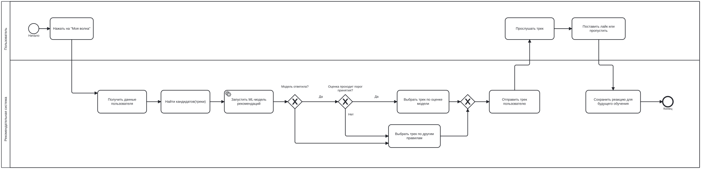

# Система рекомендаций треков в Яндекс Музыке

## Описание

В работе рассматривается система рекомендаций треков в Яндекс Музыке ("Моя волна"). Хотим выбирать следующий трек с учетом предпочтений пользователя. Для этого используется ML-модель, которая оценивает подходящие треки.

Для описания процесса я сделала BPMN и три схемы C4.

## BPMN

Сначала пользователь запускает "Мою волну". Система получает данные пользователя, находит подходящие треки и передает их ML-модели. Модель оценивает треки, потом выбирается следующий. 
Если модель не ответила или оценка слишком низкая, система выбирает трек по другим правилам. После прослушивания сохраняются лайки и пропуски, которые можно использовать для дальнейшего обучения модели.

Я сделала две версии этой схемы. Основную в BPMN 2.0 через bpmn.io и дополнительную в PlantUML (чтобы и кодом, и ручками).

## C4 System Context

На этой схеме показано, как рекомендательная система взаимодействует с пользователем, приложением Яндекс Музыка и каталогом музыки.

Пользователь слушает музыку через приложение, которое запрашивает следующий трек у рекомендательной системы. Для выбора трека система получает данные из каталога.

## C4 Containers

Здесь я подробнее рассмотрела саму рекомендательную систему.

Внутри нее есть сервис рекомендаций, ML-сервис, хранилище данных и блок обучения модели.

Сервис рекомендаций получает данные пользователя и обращается к ML-сервису за оценками треков. Данные о лайках и пропусках сохраняются в PostgreSQL, а затем могут использоваться при обучении новой модели.

## C4 Components

На последней схеме я показала, как устроен ML-сервис.

Он получает треки и признаки пользователя, передает их модели для оценки, а затем возвращает полученные оценки сервису рекомендаций. Также показана передача обновленной модели из блока обучения.

## Исходники схем

Все схемы сохранены вместе с исходным кодом.

BPMN можно открыть в [bpmn.io](https://demo.bpmn.io/), дополнительную схему в [PlantUML](https://www.plantuml.com/plantuml/), а схемы C4 в [Mermaid Live Editor](https://mermaid.live/).
